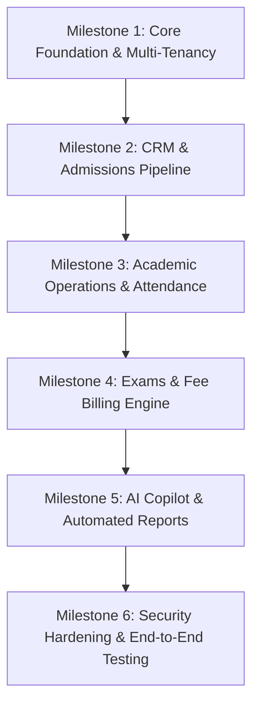

# 🛣️ Build Plan & Execution Roadmap (BUILD_PLAN.md) — CoachGenie AI

> **Target Version:** Phase 1 (MVP)  
> **Development Strategy:** Incremental Vertical Slices (Backend Schema ➡️ API Router ➡️ Service Layer ➡️ Frontend UI)

---

## 1. Phased Milestones Breakdown



---

### 📦 Milestone 1: Core Foundation & Multi-Tenancy
**Goal:** Establish database schema, multi-tenant middleware, JWT authentication, and base frontend layout.
- [x] Set up PostgreSQL database models & Alembic migrations (`backend/app/models/`).
- [x] Build multi-tenant resolver & JWT auth dependencies (`backend/app/dependencies.py`).
- [x] Create auth router: `/api/auth/login`, `/api/auth/me`, `/api/auth/register` (`backend/app/routers/auth.py`).
- [x] Set up Next.js 15 app shell with sidebar navigation, theme provider, and auth guards.

---

### 📦 Milestone 2: CRM & Admissions Pipeline
**Goal:** Enable lead capturing, follow-up scheduling, and 1-click student conversion.
- [x] Create `leads` table and SQLAlchemy schema (`backend/app/models/leads.py`).
- [x] Build Lead CRUD & Convert-to-Student API endpoints (`backend/app/routers/leads.py`).
- [x] Create Lead Kanban / Table UI in Next.js with status drag-and-drop.
- [x] Build Student Profile & Admissions Management UI (`backend/app/routers/students.py` & frontend pages).

---

### 📦 Milestone 3: Academic Operations (Batches, Subjects, Attendance)
**Goal:** Manage classroom batches, tutor allocation, and real-time attendance marking.
- [x] Implement `batches` and `batch_students` database schemas (`backend/app/models/batches.py`).
- [x] Build Batch CRUD endpoints with schedule timestamps (`backend/app/routers/batches.py`).
- [x] Implement Attendance marking router with conflict & duplicate prevention (`backend/app/routers/attendance.py`).
- [x] Build Tutor Attendance Grid UI with 1-click batch marking (`client/apps/web/`).

---

### 📦 Milestone 4: Examination & Fee Invoicing Engine
**Goal:** Test score management and installment-based fee collection with invoice generation.
- [x] Create `exams`, `exam_results`, `fees`, and `fee_payments` models.
- [x] Implement Exam scoring API with ranking & percentile algorithms (`backend/app/routers/exams.py`).
- [x] Implement Fee payment collection and receipt generation (`backend/app/routers/fees.py`).
- [x] Build Fee Ledger & Invoicing UI with PDF receipt download capabilities.

---

### 📦 Milestone 5: AI Copilot & Automated Growth Reports
**Goal:** Integrate AI reasoning engine for dropout prediction and automated growth card generation.
- [x] Integrate LangChain / LLM pipeline with prompt templates (`copilot_engine/`).
- [x] Build `/api/ai/growth-card` endpoint synthesizing attendance + test scores (`backend/app/routers/growth_cards.py`).
- [x] Create PDF & HTML report rendering pipelines with headless browser / WeasyPrint.
- [x] Implement multilingual audio/video briefing generation (`generate_multilingual_videos.py`).

---

### 📦 Milestone 6: Security Hardening & End-to-End Verification
**Goal:** Pass OWASP Top 10 compliance, verify multi-tenant isolation, and execute end-to-end regression tests.
- [x] Implement SQL Injection & XSS input sanitization filters (`test_sql_injection_defense.py`).
- [x] Enforce rate-limiting and security headers (CSP, HSTS, X-Frame-Options).
- [x] Run Playwright E2E suites for all core user journeys (`test_all_modules_multilingual.js`).
- [x] Generate comprehensive audit and QA reports (`COACHGENIE_DETAILED_QA_AND_SECURITY_AUDIT_REPORT.md`).

---

## 2. File Dependency Graph

Before creating or editing a feature, follow this strict file creation sequence:

```
1. Database Model:   backend/app/models/<feature>.py
          │
          ▼
2. Pydantic Schema:  backend/app/schemas/<feature>.py
          │
          ▼
3. Service / Logic:  backend/app/services/<feature>_service.py
          │
          ▼
4. API Router:       backend/app/routers/<feature>.py
          │
          ▼
5. Frontend API:     client/packages/api/<feature>.ts
          │
          ▼
6. UI Components:    client/apps/web/components/<feature>/
          │
          ▼
7. Page Route:       client/apps/web/app/(dashboard)/<feature>/page.tsx
```

---

## 3. Completion & Verification Checklist

- [x] Multi-Tenant Database Schema Active & Migrated
- [x] Multi-Role Authentication & JWT Active
- [x] Lead CRM & Admissions Module Active
- [x] Batch & Timetable Management Active
- [x] Daily Attendance Engine Active
- [x] Exam Results & Score Cards Active
- [x] Fee Collection & Invoicing Active
- [x] AI Student Growth Cards & Copilot Active
- [x] OWASP Top 10 Security Defense Verified
- [x] E2E Playwright Automation Verified
